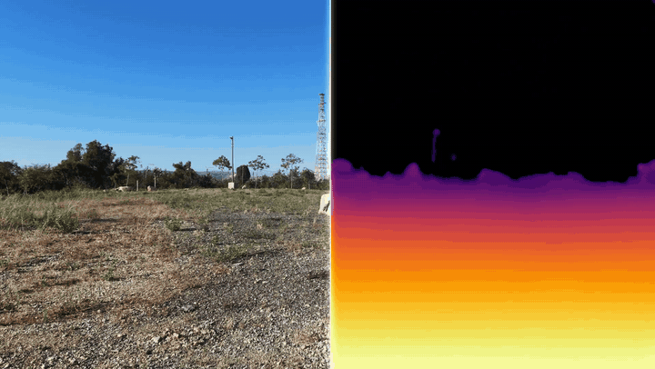

<div align="center">

<sub><b>D A N I E L</b> &nbsp;·&nbsp; Depth Anything Navigation In Exteriors, Learned</sub>

# Seeing to Drive on a Single Board

### Attention-Free Depth for Onboard Robot Navigation

**Itai Mizlish** · **Boaz Ben-Moshe**<br>
Department of Computer Science, Ariel University

[](https://arxiv.org/abs/2611.32718)
[](paper/paper.pdf)
[](https://itaim18.github.io/seeing-to-drive/)
[](https://huggingface.co/itaimizlish/daniel-student-depth)
[](https://huggingface.co/datasets/itaimizlish/daniel-yard-depth)
[](https://huggingface.co/datasets/itaimizlish/daniel-real-drives)
[](hardware/)



<sub>Left: a 4K camera, outdoors. Right: depth computed on the Raspberry Pi 5's Hailo-8L, every frame.</sub>

</div>

| **27.1 FPS** | **r = 0.99993** | **AbsRel 0.269** | **8.2 / 10** |
|:-:|:-:|:-:|:-:|
| depth at 288×512 on the Hailo-8L | int8 on the chip vs the same network in float | most accurate depth network on the chip, 400 simulated frames (next best 0.354) | goals reached without contact in a simulated yard, real Pi + Hailo in the loop (5 seeds) |

Depth foundation models are vision transformers, and the Hailo-8L runs attention in int8, where a diffuse attention weight
falls below one quantisation step. We distil Depth Anything V2-Large into a **24.5 M-parameter network with no attention**,
range obstacles from **where they meet the floor**, and run mapping, hybrid-A\* planning and SLAM **on the Pi itself**.

```
camera ─► student depth ─► ground-contact scan ─► hit-count map ─► hybrid A* ─► pure pursuit ─► PWM
          Hailo-8L, int8     metric, needs only      + ground-plane     own process    + ESC brake gate
          35 ms              the camera height        SLAM               110 ms median
```

## Quick start

```bash
git clone https://github.com/itaim18/DANIEL && cd DANIEL
pip install -U huggingface_hub numpy opencv-python onnxruntime

# the onboard loop on any video, on a laptop: depth, scan, map, plan; commands logged, nothing actuated
hf download itaimizlish/daniel-student-depth student_v5_288x512.onnx --local-dir models
python3 onboard/avoid_drive.py --backend onnx --hef models/student_v5_288x512.onnx \
    --video clip.mp4 --goal 3,0 --out run/          # -> run/commands.jsonl + run/debug.mp4
```

On a **Raspberry Pi 5 + Hailo-8L** use `student_v5_288x512_hailo8l.hef` without `--backend onnx`. The real car (Pi 5,
Hailo-8L, RealSense D435, PCA9685, Traxxas) is set up by `onboard/setup_pi.sh` and wired as in the
[electrical datasheet](hardware/DANIEL-HW-01_electrical.pdf); drive it from a browser with `onboard/cockpit.py`
([quick start](hardware/DANIEL_quick_start.pdf)).

**Reproduce Tables I and III** from the released data (byte-identical to ours):

```bash
hf download itaimizlish/daniel-yard-depth --repo-type dataset --include "bench/*" --include "hitl/*" --local-dir data
tar -C data/hitl -I zstd -xf data/hitl/runs.tar.zst
python3 bench/score.py        # Table I: depth on the chip
python3 bench/hitl_data.py    # Table III: closed loop
```

## Repository

| | |
|---|---|
| [`onboard/`](onboard) | Runs on the Pi: depth (`edge_depth.py`), ground-contact scan (`avoid.py`), map + hybrid A\* (`pathplan.py`), SLAM (`slam2d.py`), the runner (`avoid_drive.py`), the cockpit, the sensor recorder, student training + Hailo compile |
| [`car/`](car) | PWM bridge to the Traxxas (`board_server.py`), runaway failsafes, preflight |
| [`sim/`](sim) | The Isaac Sim side of the hardware-in-the-loop evaluation |
| [`bench/`](bench) | The scorers behind the paper's tables, and the on-chip benchmark |
| [`hardware/`](hardware) | Electrical datasheet (8 pp) and the car's quick start (2 pp) |
| [`paper/`](paper) | The paper, `tectonic paper.tex` |

Most modules carry a self-check: `python3 onboard/avoid.py`, `onboard/pathplan.py`, `onboard/slam2d.py`.

## Citation

```bibtex
@misc{mizlish2026seeing,
  title         = {Seeing to Drive on a Single Board: Attention-Free Depth for Onboard Robot Navigation},
  author        = {Mizlish, Itai and Ben-Moshe, Boaz},
  year          = {2026},
  eprint        = {2611.32718},
  archivePrefix = {arXiv},
  primaryClass  = {cs.RO},
  url           = {https://arxiv.org/abs/2611.32718}
}
```

<sub>Code: MIT. Model and data: CC-BY-NC-4.0, as the Depth Anything V2-Large teacher. The yard scan is of a private property and is not released.</sub>
